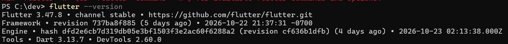
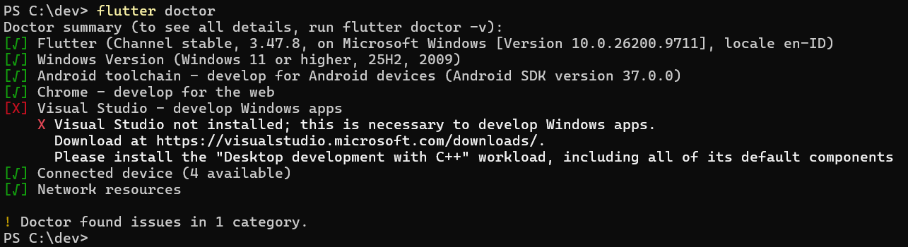
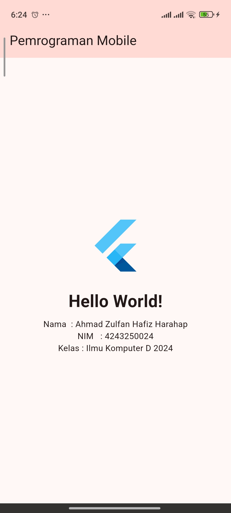

# Setup Environment & Aplikasi Hello World Flutter

a. Identitas

Nama  : Ahmad Zulfan Hafiz Harahap
NIM   : 4243250024
Kelas : PSIK24D

b. keluaran flutter --version

c. tangkap layar flutter doctor

d. tangkap layar program berjalan

e. kendala beserta solusi
1. Lokasi Android SDK mengandung spasi.
Flutter memberi peringatan karena lokasi SDK berada di dalam folder akun Windows yang namanya mengandung spasi. SDK dipindahkan ke `C:\dev`, lalu lokasi SDK di Android Studio dan Flutter disesuaikan.
2. Ruang drive C: tidak cukup saat build.
Gradle gagal menulis cache. Gradle User Home dipindahkan ke `D:\GradleHome` melalui variabel `GRADLE_USER_HOME`, sehingga cache dan distribusi Gradle disimpan di drive D:.
3. Pemasangan APK dibatalkan oleh perangkat.
ADB menampilkan `INSTALL_FAILED_USER_RESTRICTED`. Instalasi perlu disetujui pada layar HP yang tidak terkunci; USB debugging juga harus aktif di Developer options.

f. peryataan penggunaan AI
Saya menggunakan ChatGPT/Codex untuk membantu memahami pesan error dan menelusuri konfigurasi Flutter, Android SDK, Gradle, serta Git. Saya memeriksa kembali langkah yang disarankan dan menjalankannya pada lingkungan pengembangan saya.

ESAI
Pengembangan **native** membuat aplikasi khusus untuk satu sistem operasi dengan bahasa dan perangkat pengembangan resminya. Android umumnya memakai Kotlin atau Java, sedangkan iOS memakai Swift. Pendekatan ini cocok untuk aplikasi yang membutuhkan akses mendalam ke fitur perangkat, performa tinggi, atau antarmuka yang mengikuti kebiasaan platform. Contohnya adalah aplikasi kamera profesional yang memanfaatkan pemrosesan gambar dan kontrol kamera tingkat lanjut.

Pendekatan **hybrid** membangun antarmuka menggunakan teknologi web seperti HTML, CSS, dan JavaScript, lalu menjalankannya di dalam pembungkus aplikasi. Cara ini sesuai untuk aplikasi informasi atau katalog yang sebagian besar menampilkan konten web dan perlu dirilis cepat di beberapa platform.

Pendekatan **cross-platform** memungkinkan satu basis kode digunakan untuk membuat aplikasi di beberapa sistem operasi. Flutter, misalnya, menggunakan Dart dan menyediakan widget untuk menyusun antarmuka. Pendekatan ini cocok untuk aplikasi layanan kampus yang perlu tersedia di Android dan iOS dengan tampilan serta fitur utama yang konsisten. Pilihan pendekatan sebaiknya mengikuti kebutuhan performa, akses perangkat, biaya pemeliharaan, dan kemampuan tim.
